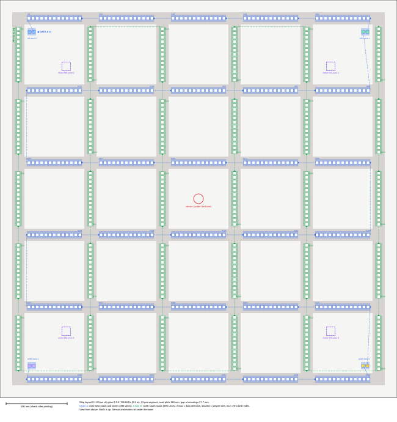

# Strip layout of the LED board (draft)

Which LED strip piece lies on which road, in which direction, and in which order the
pieces are joined. Part of M6-5 (#56), plan #28 section 3.4 ("Şerit sırası"). It is the
input of the LED map of M6-3 (`make_led_map`).

| File | What |
|---|---|
| `strip_layout.json` | Every piece: chain, first LED index, road segment, direction, and for every LED its place `t` on the segment, its board position `u, v` and its position in mm |
| `strip_layout.svg` | The same as a drawing of the 60 × 60 cm base at 1:1 (in mm). Printed at 100 % it is also a template for marking the roads on the plywood |
| `tools/strip_layout/gen-strip-layout.mjs` | Makes both files from `contracts/city_plan.json`. `--check` checks the JSON |

Pin numbers, the power drawing and the parts come in a separate document when the
parts are known (#20). Only the number of data lines (two, below) depends on them.

## Numbers

| | Value | Why |
|---|---|---|
| Base | 600 × 600 mm | doc 10.1 |
| Outer roads from the edge | 20 mm | room for the strip and the wires at the edge |
| Road pitch (centre to centre) | 112 mm | (600 − 2 × 20) / 5 |
| Strip | WS2812B, 60 LEDs/m, 10 mm wide | #20 |
| LEDs on each road segment | **5** (one piece of 83.3 mm) | the most that leaves at least 24 mm free at each crossing |
| Free space at a crossing | 28.7 mm | the other strip (about 12 mm) and about 8 mm on each side for the solder pads and the jumper wires; no LEDs in crossings (doc 10.5) |
| Store LEDs | **2 single LEDs** per store | #20 counts 8 store LEDs; the free store corner of the city plan (30 m × 30 m) is only about 22 mm on the board, so a straight piece of 4 does not fit |
| All LEDs | **308** = 60 × 5 + 4 × 2 | 5.1 m of strip; two 5 m reels (#20) are enough, with spare |

With 6 LEDs per segment the roads would have to go to the very edge of the base and
only 4 mm would stay free next to each crossing, so 5 is the proposal. The LED map does
not care: it reads the count from `strip_layout.json`.

## Two chains



- **Chain A** joins the 30 east-west roads (`h_r_c`) like a snake: row 0 to the east,
  row 1 to the west, and so on. The four stores are in this chain, where the snake
  passes their corner: NW at the start, NE after row 0, SE before row 5, SW at the end.
- **Chain B** joins the 30 north-south roads (`v_r_c`) the same way: column 0 to the
  south, column 1 to the north, and so on.

Why two: each chain has a short jumper wire across one crossing between two pieces,
or one road pitch long at the end of a row or column. With one chain for all LEDs a
jumper would have to cross the whole board. Two data lines also halve the time to send
one frame (about 4.7 ms each instead of 9.2 ms), which helps the 60 frames per second of
doc 10.5. Each chain starts in the north-west corner, near each other, so the two
data wires from the ESP32 under the base come up through one hole.

## Order of the pieces

"LEDs" is the index in the chain. The first LED of a piece is the one where the data
comes in (DIN); on the strip the small arrows must point in the direction in the last column.

**Chain A**: east-west roads h_r_c and the four stores, 158 LEDs.

| LEDs | Piece | Data runs |
|---|---|---|
| 0–1 | store 0 (NW, blue), 2 single LEDs | — |
| 2–6 | `h_0_0` (segment 0) | to the east |
| 7–11 | `h_0_1` (segment 1) | to the east |
| 12–16 | `h_0_2` (segment 2) | to the east |
| 17–21 | `h_0_3` (segment 3) | to the east |
| 22–26 | `h_0_4` (segment 4) | to the east |
| 27–28 | store 1 (NE, green), 2 single LEDs | — |
| 29–33 | `h_1_4` (segment 9) | to the west |
| 34–38 | `h_1_3` (segment 8) | to the west |
| 39–43 | `h_1_2` (segment 7) | to the west |
| 44–48 | `h_1_1` (segment 6) | to the west |
| 49–53 | `h_1_0` (segment 5) | to the west |
| 54–58 | `h_2_0` (segment 10) | to the east |
| 59–63 | `h_2_1` (segment 11) | to the east |
| 64–68 | `h_2_2` (segment 12) | to the east |
| 69–73 | `h_2_3` (segment 13) | to the east |
| 74–78 | `h_2_4` (segment 14) | to the east |
| 79–83 | `h_3_4` (segment 19) | to the west |
| 84–88 | `h_3_3` (segment 18) | to the west |
| 89–93 | `h_3_2` (segment 17) | to the west |
| 94–98 | `h_3_1` (segment 16) | to the west |
| 99–103 | `h_3_0` (segment 15) | to the west |
| 104–108 | `h_4_0` (segment 20) | to the east |
| 109–113 | `h_4_1` (segment 21) | to the east |
| 114–118 | `h_4_2` (segment 22) | to the east |
| 119–123 | `h_4_3` (segment 23) | to the east |
| 124–128 | `h_4_4` (segment 24) | to the east |
| 129–130 | store 3 (SE, yellow), 2 single LEDs | — |
| 131–135 | `h_5_4` (segment 29) | to the west |
| 136–140 | `h_5_3` (segment 28) | to the west |
| 141–145 | `h_5_2` (segment 27) | to the west |
| 146–150 | `h_5_1` (segment 26) | to the west |
| 151–155 | `h_5_0` (segment 25) | to the west |
| 156–157 | store 2 (SW, purple), 2 single LEDs | — |

**Chain B**: north-south roads v_r_c, 150 LEDs.

| LEDs | Piece | Data runs |
|---|---|---|
| 0–4 | `v_0_0` (segment 30) | to the south |
| 5–9 | `v_1_0` (segment 36) | to the south |
| 10–14 | `v_2_0` (segment 42) | to the south |
| 15–19 | `v_3_0` (segment 48) | to the south |
| 20–24 | `v_4_0` (segment 54) | to the south |
| 25–29 | `v_4_1` (segment 55) | to the north |
| 30–34 | `v_3_1` (segment 49) | to the north |
| 35–39 | `v_2_1` (segment 43) | to the north |
| 40–44 | `v_1_1` (segment 37) | to the north |
| 45–49 | `v_0_1` (segment 31) | to the north |
| 50–54 | `v_0_2` (segment 32) | to the south |
| 55–59 | `v_1_2` (segment 38) | to the south |
| 60–64 | `v_2_2` (segment 44) | to the south |
| 65–69 | `v_3_2` (segment 50) | to the south |
| 70–74 | `v_4_2` (segment 56) | to the south |
| 75–79 | `v_4_3` (segment 57) | to the north |
| 80–84 | `v_3_3` (segment 51) | to the north |
| 85–89 | `v_2_3` (segment 45) | to the north |
| 90–94 | `v_1_3` (segment 39) | to the north |
| 95–99 | `v_0_3` (segment 33) | to the north |
| 100–104 | `v_0_4` (segment 34) | to the south |
| 105–109 | `v_1_4` (segment 40) | to the south |
| 110–114 | `v_2_4` (segment 46) | to the south |
| 115–119 | `v_3_4` (segment 52) | to the south |
| 120–124 | `v_4_4` (segment 58) | to the south |
| 125–129 | `v_4_5` (segment 59) | to the north |
| 130–134 | `v_3_5` (segment 53) | to the north |
| 135–139 | `v_2_5` (segment 47) | to the north |
| 140–144 | `v_1_5` (segment 41) | to the north |
| 145–149 | `v_0_5` (segment 35) | to the north |

## Wiring rules

- Every jumper wire has three lines: 5 V, data (DOUT of one piece to DIN of the next)
  and ground. The wire goes across a crossing, next to the strip of the other road, not
  over its LEDs.
- The strip arrows show the data direction. A piece put the wrong way stops the whole
  rest of the chain, so check the arrow against the drawing before gluing.
- Each data line gets a resistor (330 Ω, #20) at the start of the chain, near the
  level shifter.
- Power goes in at the start of each chain and again in the middle, from the main 5 V
  wires under the base, so the far LEDs do not get dim. The exact feed points and wire
  sizes come with the power drawing.
- Mark the segment name (`h_2_3`, `v_0_1`) on the base next to each piece. The
  board test pattern of M6-3 lights the pieces one by one in this order, so a wrong
  piece is found at once.

## For the LED map (M6-3)

Read `strip_layout.json`:

- `chains[i].pieces[j].leds[k]` is LED `first + k` of chain `i`.
- For a road piece, `segment` and `t` give the place on the road (`t` from node `a` to
  node `b`, as in `contracts/`), so a motorcycle at `u, v` can be put on the nearest LED.
- `u, v` of every LED is also there, for the shock wave and the countdown.
- `dir` says whether the LED index grows from `a` to `b` or the other way.

## Change it

Change the numbers at the top of `tools/strip_layout/gen-strip-layout.mjs`, then:

```
node tools/strip_layout/gen-strip-layout.mjs          # writes the JSON and the drawing
node tools/strip_layout/gen-strip-layout.mjs --check  # checks the JSON
```

The check makes sure that every one of the 60 segments has exactly one piece, the LED
indices of each chain go up without a gap, no LED is in a crossing, the LEDs of a piece
follow its direction, and all four stores are there.

## Open points

- **5 or 6 LEDs per segment.** #20 counted 336 LEDs on the roads (5.6 per segment).
  5 is proposed for the room at the crossings. Decide before the strip is cut.
- **2 store LEDs.** #20 says 8 store LEDs in all; the issue text says "four store LEDs".
  Two single LEDs per store is what fits next to the free store corner.
- **Data pins.** Two data lines need two ESP32 pins and two channels of the level
  shifter. They come in the pin table when the parts are known.
- **Board edge.** 20 mm from the edge is a proposal; if the base gets a frame, change
  `MARGIN_MM`.
