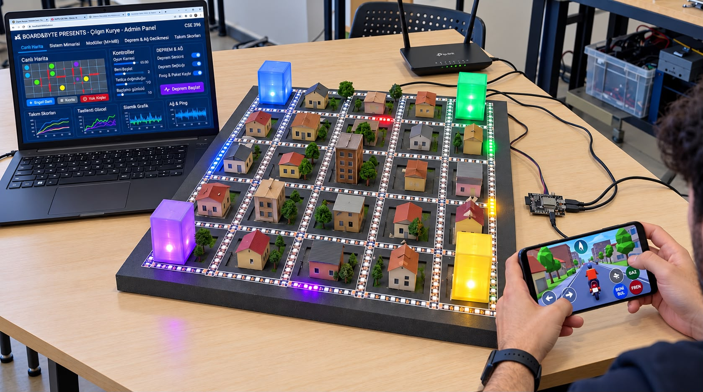
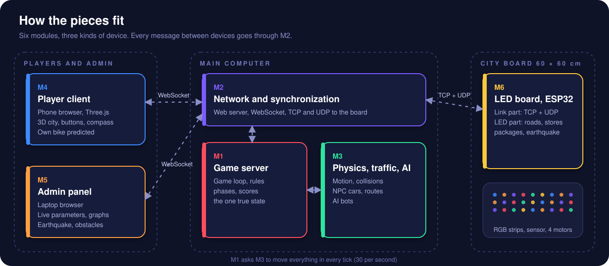
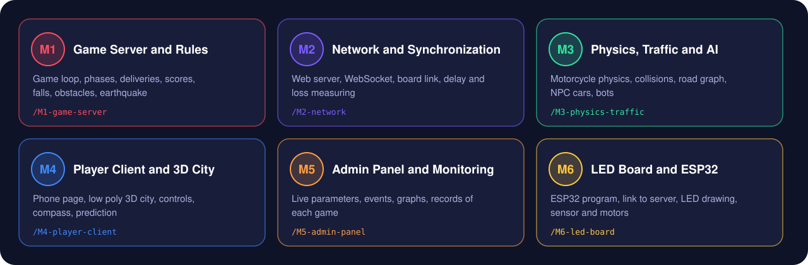

<p align="center">
  
</p>

<p align="center">
  <a href="docs/proposals/modules-and-requirements/v2.0/Cilgin_Kurye_Modules_and_Requirements.pdf"></a>
  
  
  
</p>

<p align="center">
  <b>CSE 396 Project</b> · Gebze Technical University · Group 8 · <b>Board&amp;Byte</b>
</p>

---

## The idea

Up to four teams deliver packages with motorcycles in a 3D city on their phones.
**There is no map on the phone.** Only a compass arrow shows the direction. The real map is a
**60 × 60 cm LED city board** on the table: roads, stores, packages, obstacles and every player
light up there in real time. To win, players must look up from the phone and read the board.

An admin computer changes the game while it runs (speed, grip, traffic, obstacles, an earthquake)
and watches the results in the 3D city, on the board and in live graphs.

<p align="center">
  
</p>

## Architecture

<p align="center">
  
</p>

| Device | Modules | What runs there |
| --- | --- | --- |
| Player phone | M4 | Web page with the 3D city. Nothing to install |
| Main computer | M1, M2, M3 | Game server, network, physics, traffic and AI bots |
| Admin laptop | M5 | Web page with live parameters and graphs |
| City board | M6 | One ESP32 with LED strips, a vibration sensor and 4 motors |

## Modules

<p align="center">
  
</p>

| Module | Folder | Document | Members |
| --- | --- | --- | --- |
| **M1** Game Server and Rules | [`M1-game-server/`](M1-game-server) | [v2.0](docs/proposals/M1-game-server/v2.0/M1-proposal.pdf) | Tuğberk Akbulut, Abdullatif Yılmaz, Berk Andaçgil, Selim Barut, Umutcan Ocak |
| **M2** Network and Synchronization | [`M2-network/`](M2-network) | [v2.0](docs/proposals/M2-network/v2.0/M2-proposal.pdf) | Tuğberk Akbulut, Ayşe Poyraz, Hasan Hüseyin Özdemir, Umutcan Ocak |
| **M3** Physics, Traffic and AI | [`M3-physics-traffic/`](M3-physics-traffic) | [v2.0](docs/proposals/M3-physics-traffic/v2.0/M3-proposal.pdf) | Abdullatif Yılmaz, Hasan Alperen Elmas, Batuhan Yanar, Selim Barut, Muhib Taha Boy |
| **M4** Player Client and 3D City | [`M4-player-client/`](M4-player-client) | [v2.0](docs/proposals/M4-player-client/v2.0/M4-proposal.pdf) | Abdullatif Yılmaz, Berk Andaçgil, Selim Barut |
| **M5** Admin Panel and Monitoring | [`M5-admin-panel/`](M5-admin-panel) | [v2.0](docs/proposals/M5-admin-panel/v2.0/M5-proposal.pdf) | Batuhan Yanar, Ayşe Poyraz, Berk Andaçgil |
| **M6** LED Board and ESP32 | [`M6-led-board/`](M6-led-board) | [v2.0](docs/proposals/M6-led-board/v2.0/M6-proposal.pdf) | Tuğberk Akbulut, Hasan Alperen Elmas, Hasan Hüseyin Özdemir, Muhib Taha Boy, Ayşe Poyraz, Umutcan Ocak |

All modules together, with the requirements and the system design:
[**Modules and Requirements v2.0**](docs/proposals/modules-and-requirements/v2.0/Cilgin_Kurye_Modules_and_Requirements.pdf).

## Repository layout

```text
cilgin-kurye/
├── M1-game-server/       game loop, rules, phases, scores
├── M2-network/           web server, WebSocket, board link
├── M3-physics-traffic/   motorcycle physics, NPC traffic, AI bots
├── M4-player-client/     phone web page, 3D city
├── M5-admin-panel/       admin web page, live graphs
├── M6-led-board/         ESP32 program, LED drawing, wiring and 3D models
├── contracts/            shared city plan, message formats, protocol test vectors
├── tools/                generators, checkers and emulators
└── docs/
    ├── proposals/        module documents, one folder per version
    ├── decisions/        technology and process decisions
    └── assets/           pictures used in this README
```

Each module folder has its own README with its inputs, outputs and planned layout. The code is not
written yet; the documents in `docs/proposals/` describe what each module will do.

## How we work

1. Every task is an issue on the GitHub Project board, labelled with its module (`M1` … `M6`).
2. Work on a branch named `<module>/<short-topic>`, for example `m3/npc-traffic` or `m6/udp-link`.
3. Open a pull request into `main`. At least one reviewer **from another module** approves before merging.
4. Nobody pushes directly to `main`. (Branch protection is not enforced on a private free repository, so this is a team rule.)
5. A change in `contracts/` needs the `contracts` label and approval from every module that uses the file. Increase the version number in the file.
6. A new document version goes into a new folder (`v1.1`, `v2.0`, …). Old version folders are never changed; CI checks this.

## Shared contracts

Run these after changing anything in `contracts/` or `tools/`:

```bash
pip install msgpack
python3 tools/gen_city_plan.py         # regenerate contracts/city_plan.json
python3 tools/gen_protocol_vectors.py  # regenerate contracts/board_protocol_vectors.json
python3 tools/check_contracts.py       # the same check that CI runs
```

See [`contracts/README.md`](contracts/README.md) for the ID rules and coordinates.

---

<p align="center"><sub>Board&amp;Byte · Gebze Technical University · 2026</sub></p>
